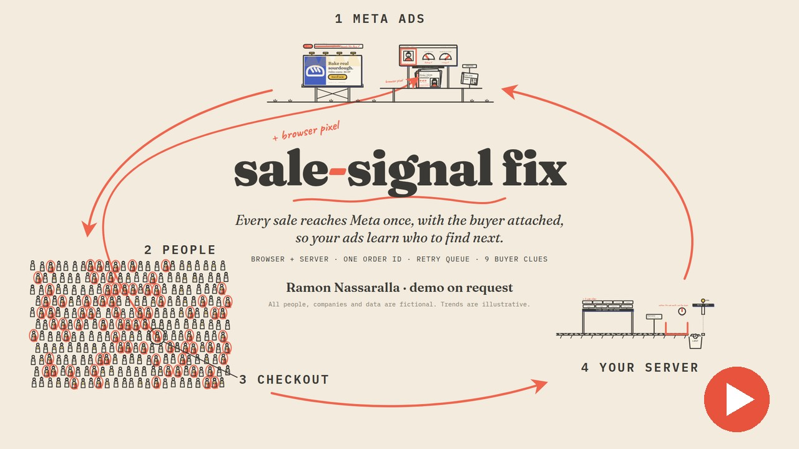
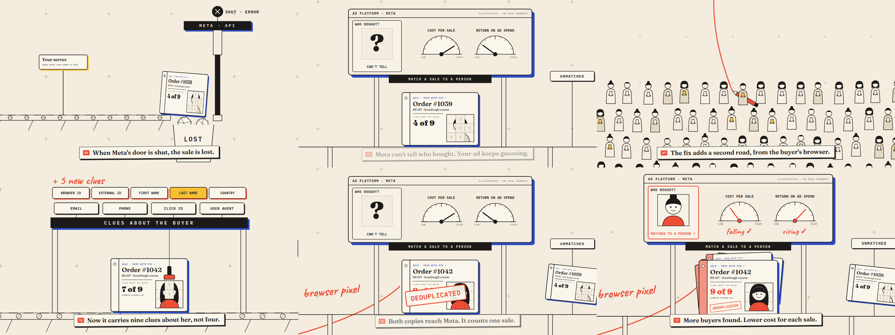
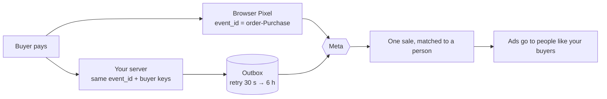

# Sale Signal Fix

*Every sale reaches Meta once, with the buyer attached, so your ads learn who to find next.*

**A tracking audit and fix for stores and info products that sell with Meta ads. The sale already shows up in Ads Manager. The fix makes sure Meta also knows who bought, so every sale teaches the campaign who to look for.**

*71 seconds, no voice. Click the image to watch. All people, companies and data in the video are fictional; the cost and return trends on screen are illustrative.*

## 1. The problem

The sale is counted in Ads Manager, so everything looks fine. But in many setups it reaches Meta by one road only, with few details about the buyer. Meta counts the sale and can't tell well who bought. And when Meta's API is down for a moment, the sale is simply lost.

So you pay for the click, the sale happens, and the algorithm keeps guessing who to show the ad to. The more budget, the more it guesses.

## 2. What it fixes

1. **Two roads, one sale.** The browser Pixel and the Conversions API send the same sale with the same `event_id`. Meta shows it as *Deduplicated* and counts it once.
2. **More about the buyer.** The server sends more buyer keys, normalized and hashed the way Meta asks: e-mail, phone, first and last name, country, external id, browser id and click id. On Meta's Test Events screen this went from 4 keys to 9.
3. **No lost sales.** An outbox with retry holds the sale when Meta is down and sends it later. The checkout no longer waits on Meta: 3.01 s → 0.01 s when Meta was slow.

Fix 2 is what changes the campaign. When Meta knows who bought, it finds more people like the real buyers. No number is promised here, since results also depend on offer, creative and budget. The direction is: cost per sale down, ROAS up, and a campaign that learns faster.

## 3. How it works

**Stack:** Python, SQLite outbox, Meta Pixel, Meta Conversions API (Graph API), plain JavaScript. Works with an own checkout; on hosted checkouts (Hotmart, Kiwify, Eduzz, Shopify) the audit is the same and the fix goes as far as each platform lets you configure.

## 4. Proof that it works

| What | Result | Report |
|---|---|---|
| Audit of an open-source sales funnel, every finding asserted on what actually left the server | 7 of 7 gaps reproduced; the 3 that change what Meta learns fixed | [proof/AUDIT.md](proof/AUDIT.md) |
| Meta Test Events, test pixel, fictional buyer | Purchase and InitiateCheckout **Deduplicated**; 9 user data keys (was 4); Event Match Quality 7.7 on the test dataset | [proof/AUDIT.md](proof/AUDIT.md#4-proof-on-metas-own-screens-test-pixel-2026-11-21) |
| Meta outage simulated (Graph API returns 500, then 3 s delay) | 0 sales lost, 2 resent after the outage; checkout 3.01 s → 0.01 s | [proof/evidence-after.json](proof/evidence-after.json) |
| Automated tests | 70 of 70 pass (the funnel's own suite + 6 for the fixes) | code walkthrough on a call |

The audited funnel is [funil-aberto](https://github.com/thiagopatzdorf/funil-aberto) (MIT). Credit to its authors; the findings are about tracking, not about the quality of their project.

## 5. Where this comes from

I have 4 years of hands-on work in paid media and growth, and I have fixed this kind of tracking in client accounts before. Those client numbers stay private. This repository is the rebuilt, documented version: an audit anyone can check, and a fix proven on Meta's own screens with fictional data.

Google Ads is next, as a separate module with the same buyer data.

## 6. The code

The code is private for now. I walk through it, and run it live, on a call.

Want Meta to know who is buying from your ads? Message me on [LinkedIn](https://www.linkedin.com/in/ramon-nassaralla-322a54180) or at nassaralla23@gmail.com.

**Ramon Nassaralla** · GTM / AI Automation · [LinkedIn](https://www.linkedin.com/in/ramon-nassaralla-322a54180)
